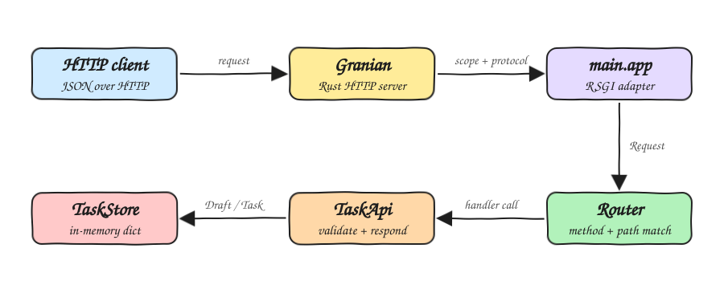

# Granian Fun

Granian Fun is a small tasks REST API written in typed Python 3.14 and served by [Granian](https://github.com/emmett-framework/granian), the Rust HTTP server for Python. It uses no web framework: the app speaks RSGI, Granian's native interface, through a tiny typed router. The whole code base passes `mypy --strict`.

## How it Works

1. Granian accepts the HTTP connection in Rust and calls `main.app(scope, transport)` on its single Python worker.
2. `main.app` reads the method, path, query string and body, and builds an immutable `Request`.
3. `Router.dispatch` matches the method and the path against the route table and fills the path parameters.
4. The matching `TaskApi` handler validates the input and talks to the `TaskStore`.
5. The handler returns a `Response` with a status and a JSON payload.
6. `main.app` sends it back with `response_str`, or `response_empty` for a `204`.
7. Any `HttpError` raised on the way becomes a JSON error body with the right status.

## Architecture



## Features

* Task CRUD: create, read, replace and delete tasks over JSON.
* Filter by state: `GET /tasks?done=true` returns only finished tasks, `done=false` only open ones.
* Strict validation: a blank title, a non-boolean `done` or broken JSON is answered with `400` and nothing is stored.
* Precise errors: an unknown path is `404`, a known path with the wrong method is `405`, both as JSON.
* Stable ids: ids only grow, so a deleted id is never handed to a new task.
* Health check: `GET /health` reports that the server is up and how many tasks it holds.

## Stack

* Python 3.14: `type` aliases, structural pattern matching and slotted frozen dataclasses.
* Granian 2.8: Rust HTTP server that runs the app through the RSGI interface.
* mypy in strict mode: every function, alias and protocol is type checked.
* unittest: the standard library test runner, so tests need no extra dependency.
* Bash: operational scripts to set up, start, check, test and stop the app.

## Contracts/APIs

The base URL is `http://localhost:8000`. Every body is JSON.

| Method | Path | Body | Success | Errors |
|---|---|---|---|---|
| `GET` | `/health` | none | `200` `{"status": "up", "tasks": 0}` | none |
| `GET` | `/tasks` | none | `200` list of tasks | `400` bad `done` filter |
| `POST` | `/tasks` | `{"title": "buy milk", "done": false}` | `201` the new task | `400` invalid body |
| `GET` | `/tasks/{id}` | none | `200` the task | `404` unknown id |
| `PUT` | `/tasks/{id}` | `{"title": "buy oat milk", "done": true}` | `200` the replaced task | `400` invalid body, `404` unknown id |
| `DELETE` | `/tasks/{id}` | none | `204` no body | `404` unknown id |

A task looks like this:

```json
{"id": 1, "title": "buy milk", "done": false}
```

`title` is required and must be a non-empty string. `done` is optional, must be a boolean and defaults to `false`. An error looks like this:

```json
{"error": "task 2 was not found"}
```

Calling the API from a shell:

```bash
curl -X POST http://localhost:8000/tasks -d '{"title": "buy milk"}'
curl http://localhost:8000/tasks
curl -X PUT http://localhost:8000/tasks/1 -d '{"title": "buy oat milk", "done": true}'
curl "http://localhost:8000/tasks?done=true"
curl -X DELETE http://localhost:8000/tasks/1
```

## Key Data Structures and Design Decisions

* `Json` is a recursive `type` alias, so every payload that enters or leaves the API is checked by mypy.
* `Request`, `Response`, `Draft` and `Task` are frozen dataclasses with slots. A `Draft` is validated input without an id, a `Task` is a stored value with one.
* `parse_draft` validates a body with one `match` statement over the JSON shape, with no schema library.
* `Scope` and `Transport` in `src/main.py` are `Protocol` classes that describe only the part of RSGI the app uses. Granian's objects satisfy them and so do the fakes in the tests.
* Handlers are plain functions from `Request` to `Response`. They never touch the server, so the whole API is tested without a socket.
* The store is a `dict` inside the worker process. Granian is started with one worker so every request sees the same tasks. Tasks are lost on restart.

## How to Run

```bash
./scripts/setup.sh
./scripts/start-all.sh
./scripts/status.sh
./scripts/stop-all.sh
```

## How to Test

```bash
./scripts/test-all.sh
```

This runs `mypy --strict` over `src` and `tests`, then the 18 unit tests.

## Scripts

All scripts live in `scripts/` and run from any directory of the repository.

| Script | What it does |
|---|---|
| `./scripts/setup.sh` | Creates the virtualenv on Python 3.14 and installs the dependencies |
| `./scripts/start-all.sh` | Starts Granian and prints the full link of the API |
| `./scripts/status.sh` | Shows the backend port as UP or DOWN, and exits non-zero when it is DOWN |
| `./scripts/test-all.sh` | Runs the type check and every test suite |
| `./scripts/stop-all.sh` | Stops Granian and frees the port |

Ports are declared in `scripts/ports.env`.

```bash
./scripts/setup.sh
./scripts/start-all.sh
./scripts/status.sh
./scripts/stop-all.sh
```
