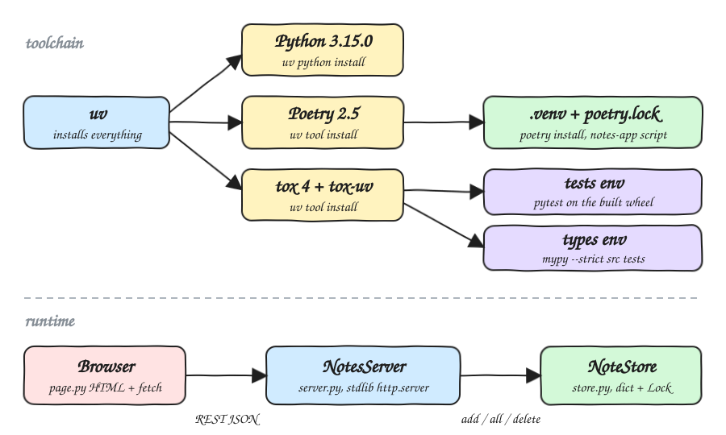
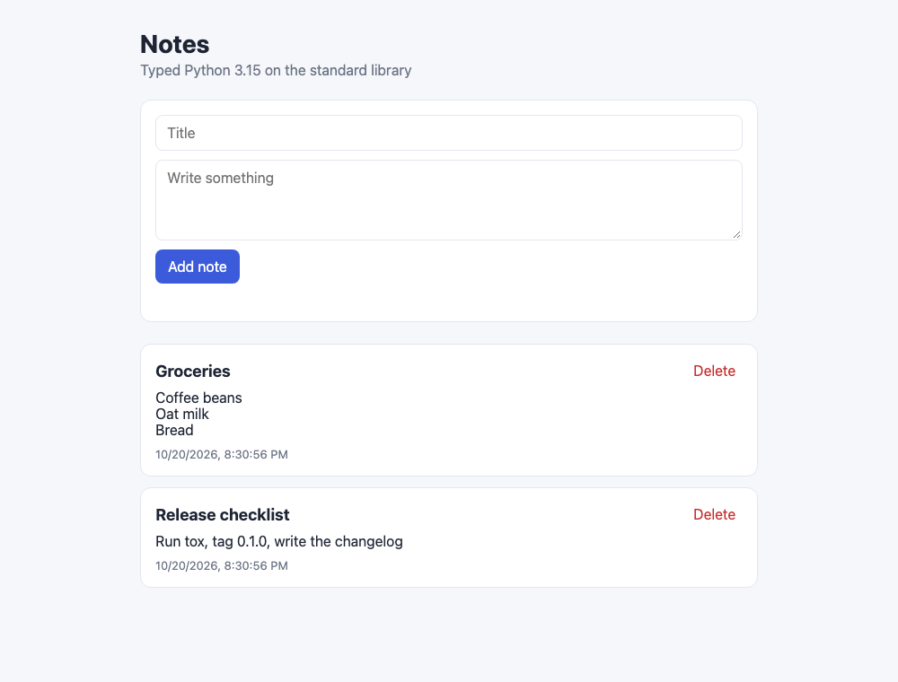
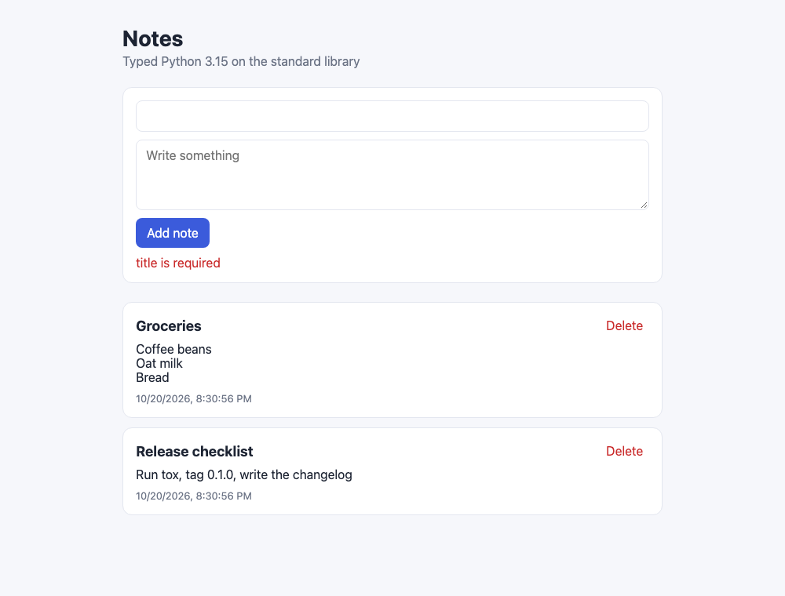

# poetry-tox-fun

A small notes web app written in typed Python 3.15. It uses only the standard library at runtime. uv installs the toolchain, Poetry builds and installs the app, tox runs the tests and the type check, and mypy checks the types in strict mode.

## How it Works

1. `uv` installs Python 3.15.0 and installs `poetry` and `tox` (with the `tox-uv` plugin) as tools.
2. `poetry install` creates `.venv/` from `pyproject.toml` and `poetry.lock`, and installs the `notes-app` console script.
3. `tox` builds a wheel with `poetry-core`, then runs two environments: `tests` (pytest) and `types` (mypy strict).
4. `notes-app` starts a `ThreadingHTTPServer` on port 8080.
5. `GET /` returns the HTML UI. The UI uses `fetch` against `/api/notes` to list, create and delete notes.
6. `NoteStore` keeps notes in memory in a dict guarded by a `Lock`. It validates and trims every field before storing it.

## Architecture



## Features

* Notes UI: one page to add, list and delete notes, served by the same process as the API.
* REST JSON API: plain HTTP routes that you can script with any client.
* Input validation: titles are required, fields are trimmed and size-limited, and non-string JSON is rejected with a 400 and a reason.
* Stable ids: ids are never reused, so a deleted note's URL never points to a different note.
* No runtime dependencies: `http.server`, `json`, `dataclasses` and `threading` are enough.
* Strict typing: `mypy --strict` checks `src/` and `tests/`, and the package ships `py.typed`.

## Stack

* Python 3.15.0: the latest CPython release.
* uv: installs the Python interpreter and the Poetry and tox tools in seconds.
* Poetry 2.5: owns the lock file, the virtualenv, the build backend (`poetry-core`) and the console script.
* tox 4 + tox-uv: runs tests and types in isolated environments against the built package, not the source tree.
* pytest: the test runner.
* mypy: the strict static type checker.

## Contracts / APIs

| Method | Path | Body | Response |
|---|---|---|---|
| GET | `/` | | HTML UI |
| GET | `/health` | | `200 {"status": "UP"}` |
| GET | `/api/notes` | | `200 [Note]`, newest first |
| GET | `/api/notes/{id}` | | `200 Note` or `404 {"error": "not found"}` |
| POST | `/api/notes` | `{"title": str, "body": str}` | `201 Note` or `400 {"error": reason}` |
| DELETE | `/api/notes/{id}` | | `204` or `404 {"error": "not found"}` |

```json
{"id": 1, "title": "Groceries", "body": "Coffee beans", "created_at": "2026-10-20T20:30:56+00:00"}
```

Limits: title 1 to 120 characters, body up to 2000 characters, request body up to 16384 bytes.

## Key Data Structures and Design Decisions

* `Note` is a frozen, slotted dataclass. It cannot change after it is created, so it is safe to share across request threads.
* `NoteStore` holds a `dict[int, Note]` and a counter that only goes up. Each operation runs under one `Lock`.
* `NotesServer` subclasses `ThreadingHTTPServer` and holds the store. The handler reads the store from `self.server`, so there is no global state.
* Validation lives in the store, not in the handler, so every caller gets the same rules.
* The dev tools are declared once, in `[dependency-groups]`. Poetry installs them into `.venv/`, and tox installs them into its own environments.

## Project Layout

```
src/notes_app/store.py     Note, NoteStore, validation
src/notes_app/server.py    NotesServer, NotesHandler, routes
src/notes_app/page.py      HTML UI
src/notes_app/__main__.py  notes-app entrypoint
tests/test_store.py        store rules
tests/test_server.py       HTTP tests against a real server on a random port
pyproject.toml             project, Poetry, mypy and pytest config
tox.toml                   tests and types environments
```

## How to Run

```bash
./scripts/setup.sh
./scripts/start-all.sh
./scripts/test-all.sh
```

Without the scripts:

```bash
poetry install
poetry run notes-app
poetry run pytest
poetry run mypy
tox
tox -e tests
tox -e types
```

Test output:

```
tests: commands[0]> pytest
collected 14 items

tests/test_server.py ........                                            [ 57%]
tests/test_store.py ......                                               [100%]

============================== 14 passed ==============================
types: commands[0]> mypy
Success: no issues found in 7 source files
  tests: OK
  types: OK
  congratulations :)
```

## Printscreens

### Notes list



Two notes were created through the API. The newest note is on top. Multi-line bodies keep their line breaks, and each card shows when the note was created and has a Delete button.

### Validation error



A note with a title made only of spaces was submitted. The server trimmed the title, rejected it with `400 {"error": "title is required"}`, and the UI showed that reason under the form. Nothing was stored.

## Scripts

All scripts live in `scripts/` and run from any directory of the repository.

| Script | What it does |
|---|---|
| `./scripts/setup.sh` | Installs dependencies and prepares the app |
| `./scripts/start-all.sh` | Starts every service and prints the full link of each one |
| `./scripts/status.sh` | Shows every service port as UP or DOWN |
| `./scripts/test-all.sh` | Runs every test suite |
| `./scripts/ui.sh` | Opens the UI in the browser |
| `./scripts/stop-all.sh` | Stops every service |

Ports are declared in `scripts/ports.env`.

```bash
./scripts/setup.sh
./scripts/start-all.sh
./scripts/status.sh
./scripts/ui.sh
./scripts/stop-all.sh
```
