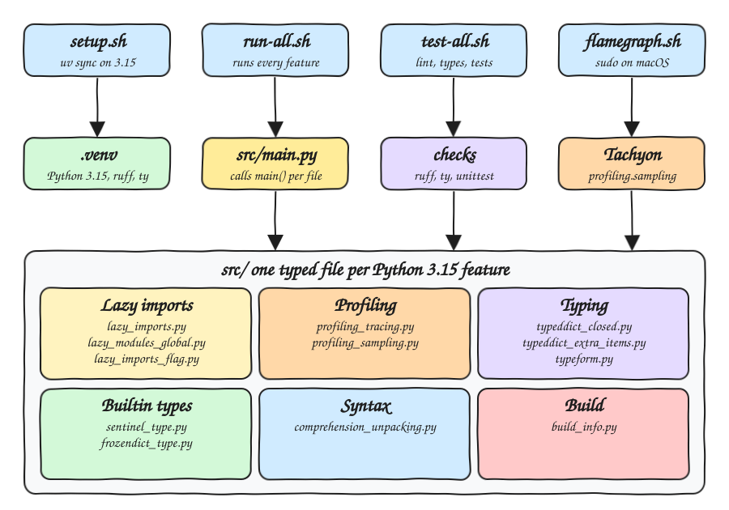

# python-3-15-fun

A proof of concept that exercises every Python 3.15 feature described in the
[Astral Python 3.15 post](https://astral.sh/blog/python-3.15), with one typed file per feature,
managed by uv, linted by Ruff and type checked by ty.

## How it Works?

* `uv` installs CPython 3.15 and creates `.venv` with `ruff` and `ty` as the only dev tools.
* Each file in `src/` covers exactly one feature and exposes typed functions plus a `main()`.
* `src/main.py` imports every feature module and calls its `main()` in order.
* Lazy import files are verified in a fresh interpreter, because a module can only be observed
  as not loaded before anything else touches it.
* `ty` proves the typing features: `sum(point.values())` only type checks because the
  `TypedDict` is `closed=True` or declares `extra_items=int`.
* Ruff runs the new lazy import rules `TID254`, `TID255` and the updated `TC003` and `RUF017`.
* Tachyon, the sampling profiler, runs from its own script because it needs elevated permissions.

## Architecture



## Features

| Feature | File | What it shows |
|---|---|---|
| `lazy` keyword, PEP 810 | `src/lazy_imports.py` | `tomllib` sits in `sys.lazy_modules` and is loaded only on first runtime use, an annotation does not load it |
| `__lazy_modules__` global, PEP 810 | `src/lazy_modules_global.py` | Same laziness with syntax older Pythons still parse |
| `-X lazy_imports=all` and `PYTHON_LAZY_IMPORTS=all` | `src/lazy_imports_flag.py` | Makes every plain `import` lazy without touching the source |
| `profiling.tracing` | `src/profiling_tracing.py` | Deterministic profiler, counts all 177 calls of `fibonacci(10)` |
| `profiling.sampling`, Tachyon | `src/profiling_sampling.py` | Statistical profiler that writes a flame graph of a quadratic `sum(lists, [])` |
| `TypedDict(closed=True)`, PEP 728 | `src/typeddict_closed.py` | No extra keys, so values are `int` instead of `object` |
| `TypedDict(extra_items=int)`, PEP 728 | `src/typeddict_extra_items.py` | Any number of extra keys, all typed as `int` |
| `typing.TypeForm`, PEP 747 | `src/typeform.py` | Types a `trycast` that takes a type expression such as `str \| None` |
| `sentinel` builtin, PEP 661 | `src/sentinel_type.py` | Named default that differs from `None`, readable in signatures, survives copy and pickle |
| `frozendict` builtin, PEP 814 | `src/frozendict_type.py` | Immutable, hashable mapping usable as a dict key |
| Unpacking in comprehensions, PEP 798 | `src/comprehension_unpacking.py` | `[*row for row in rows]` and `{**m for m in maps}` |
| Clang built interpreter | `src/build_info.py` | Reports version, compiler and architecture of the running build |

The post also covers three items that are not runnable code on this platform: the Clang
performance boost and ARM64 default builds on Windows, the end of life of Python 3.10 and the
removal of `ruff-lsp`. `src/build_info.py` reports the compiler and architecture so the Windows
points can be checked on a Windows machine.

## Stack

* Python 3.15: the release under test.
* uv: installs the interpreter and the virtualenv.
* Ruff 0.17: lint with the new lazy import rules.
* ty: type checker that understands `closed`, `extra_items`, `TypeForm` and `sentinel`.
* unittest: standard library test runner, no test dependency.

## Design decisions

* No runtime dependencies. The sampling workload replaces the RDKit dataset from the post with
  generated molecules, it keeps the same quadratic `Counter(sum(symbols, []))` hotspot.
* `RUF017` is ignored only for `src/profiling_sampling.py`, the slow summation is the hotspot the
  flame graph is meant to reveal. The fix it recommends lives in `src/comprehension_unpacking.py`.
* `ban-lazy = ["sys"]` and `require-lazy = ["tomllib"]` in `pyproject.toml` enforce `TID254`.
* Ruff asked for `lazy from collections.abc import Iterator` through the updated `TC003`, the
  import is used only in an annotation.

## How to run

```bash
./scripts/setup.sh
./scripts/run-all.sh
./scripts/test-all.sh
./scripts/flamegraph.sh
```

A single feature runs on its own:

```bash
.venv/bin/python src/frozendict_type.py
```

### Result

```
== lazy_imports
before use: loaded=False pending=True
{'tool': {'ruff': {'target-version': 'py315'}}}
after use: loaded=True pending=False

== lazy_modules_global
before use: {'decimal': False, 'fractions': True}
half=0.5 third=1/3
after use: {'decimal': True, 'fractions': True}

== lazy_imports_flag
default: normal True
-X lazy_imports=all: all False
PYTHON_LAZY_IMPORTS=all: all False

== profiling_tracing
fibonacci(10) traced calls: 177

== typeddict_closed
closed=True total=7

== typeddict_extra_items
extra_items=int total=12

== typeform
str | None with 'hi': 'hi'
int with 'hi': None
int | float with 2.5: 2.5

== sentinel_type
resolve(value: int | None | MISSING = MISSING) -> str
resolve() -> not provided
resolve(None) -> explicit None
resolve(7) -> value 7
identity kept after copy=True pickle=True

== frozendict_type
defaults=frozendict({'retries': 3, 'timeout': 30})
tuned=frozendict({'retries': 3, 'timeout': 5})
immutable=True
usage=Counter({frozendict({'retries': 3, 'timeout': 30}): 2, frozendict({'retries': 3, 'timeout': 5}): 1})

== comprehension_unpacking
flatten=[1, 2, 3, 3, 4, 5]
unique={1, 2, 3, 4, 5}
merge={'a': 3, 'b': 2}
stream=[1, 2, 3, 3, 4, 5]

== build_info
python 3.15.0 built with Clang 22.1.3  for Darwin arm64

== profiling_sampling
not run here: Tachyon needs elevated permissions, run ./scripts/flamegraph.sh
```

## Scripts

All scripts live in `scripts/` and run from any directory of the repository. The project is a
set of command line programs, so there are no services, ports or UI to start and stop.

| Script | What it does |
|---|---|
| `./scripts/setup.sh` | Installs Python 3.15 with uv, syncs `.venv` and rejects a pre-release interpreter |
| `./scripts/run-all.sh` | Runs every feature through `src/main.py` |
| `./scripts/test-all.sh` | Runs Ruff, ty and the unit tests, fails on the first failing step |
| `./scripts/flamegraph.sh` | Runs Tachyon and writes `.run/flamegraph.html`, asks for sudo on macOS |

`uv` 0.13 or newer is required to find the final 3.15 build, run `uv self update` first.
